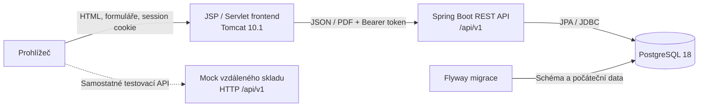
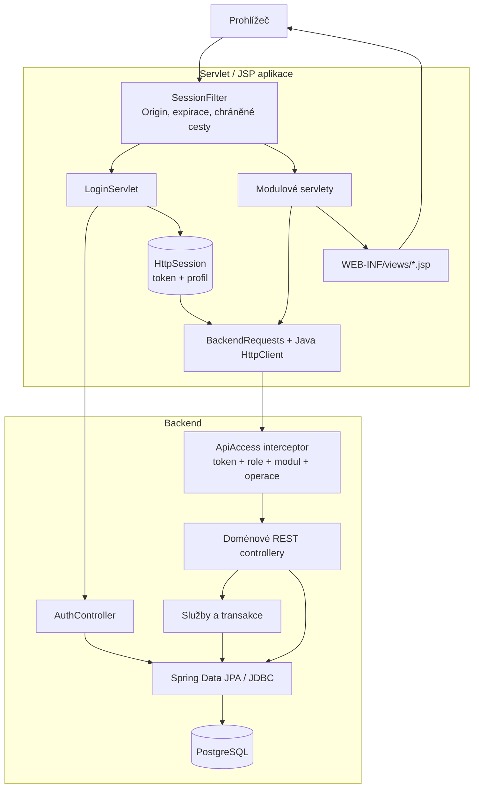
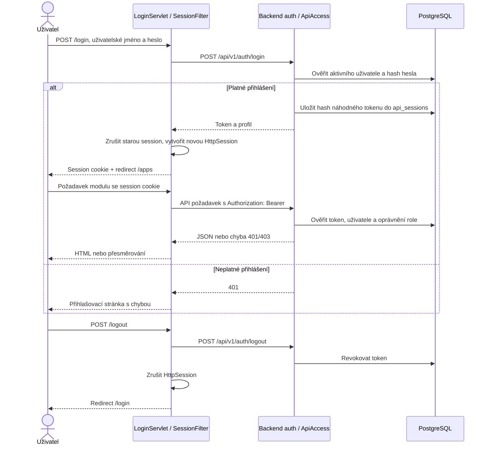
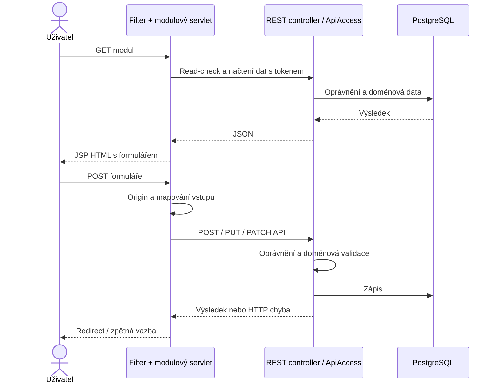
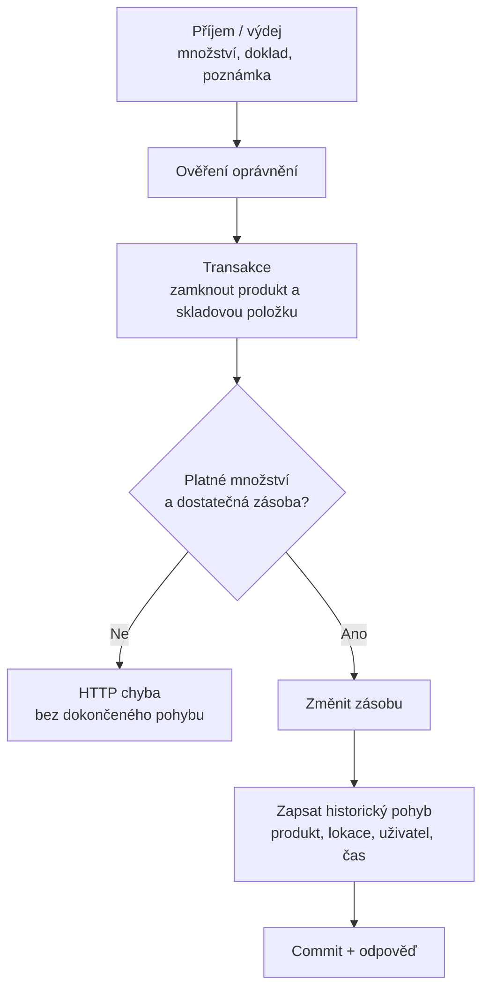
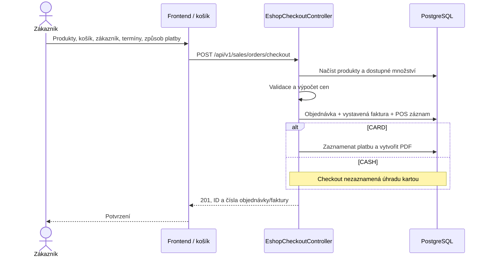
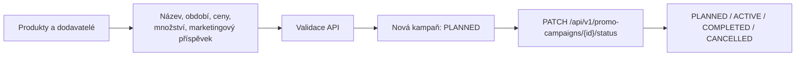
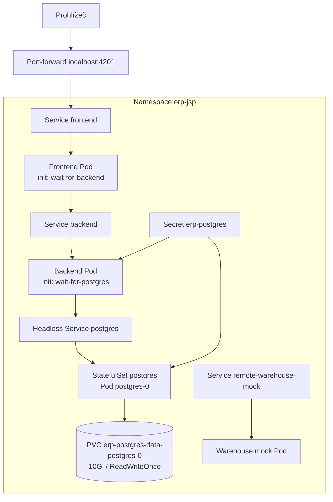
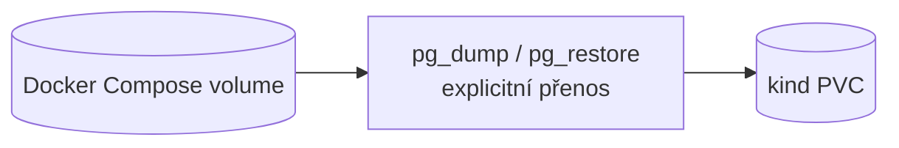

# ERP — úplná architektura a provoz JSP varianty (kind)

Tento dokument popisuje aktuální implementaci, nikoli návrh budoucího systému.
Jde o variantu průvodce pro lokální Kubernetes cluster vytvořený pomocí kind;
pro práci s clusterem používá přímo `kubectl`.
Výchozí variantou je Java Servlet/JSP frontend. Ostatní varianty mají vlastní
dokumenty:

- [PHP / Symfony](./ARCHITECTURE-FULL-PHP.md)
- [Next.js / první React frontend](./ARCHITECTURE-FULL-NEXTJS.md)
- [Next.js / Twig.js](./ARCHITECTURE-FULL-NEXTJS2.md)
- [Next.js / React TSX](./ARCHITECTURE-FULL-NEXTJS3.md)

## 1. Služby a odpovědnosti

| Komponenta | Technologie | Odpovědnost |
| --- | --- | --- |
| [JSP frontend](./erp-base-frontend) | Java 21, Servlets, JSP, Jackson, Tomcat 10.1 | HTML, formuláře, session, volání API |
| [Backend](./erp-backend) | Spring Boot 4.1.1, Java 21, Spring MVC, JPA | Autorizace, doménová pravidla, transakce |
| PostgreSQL | PostgreSQL 18 | Obchodní data, role, hashované API sessions |
| [Mock skladu](./erp-remote-warehouse) | Samostatná Java HTTP služba | Testovací katalog a dostupnost v paměti |
| Flyway | SQL migrace v backendu | Schéma a počáteční data |

Frontend a backend jsou samostatné aplikace. Frontend není Spring Boot:
Maven vytváří WAR, který Dockerfile nasadí do Tomcatu jako `ROOT.war`.
Backend je spustitelný JAR. Prohlížeč běžně komunikuje s frontendem,
nikoli přímo s databází nebo s chráněným backend API.



Compose mock spouští, ale samotné spuštění mocku automaticky nezapojuje
jeho data do backendu. Nejde o repliku ERP skladu ani databázovou zálohu.

## 2. Vnitřní vrstvy



Část controllerů používá repositories přímo; ne všechny operace mají
samostatnou servisní vrstvu. Backend je autoritou pro každou API operaci:
skrytí tlačítka nebo frontendový read-check oprávnění backend nenahrazuje.

### Doménová mapa

| Oblast | Moduly |
| --- | --- |
| Identita a správa | users, roles, companies, settings |
| Produkty a obchod | catalog, sales, purchase, accounting, POS, promo |
| Provoz | inventory, manufacturing, planning, HR |
| Spolupráce a obsah | CRM, projects, helpdesk, marketing, documents, website, dashboard |

PDF účetních dokumentů vytváří backend pomocí PDFBox. Databázové schéma
mění Flyway; Hibernate ho při startu pouze validuje (`ddl-auto: validate`).

## 3. Zásadní workflow

### 3.1 Přihlášení, autorizace a odhlášení



Token je v serverové session, nikoli v browserovém úložišti. Backend ukládá
jeho hash do `api_sessions` a vystavuje token s osmihodinovou platností.
JSP session má limit 30 minut neaktivity a osm hodin celkem.
Mutace ve frontendu kontrolují stejný Origin/Referer.
Tomcat sessions nemají v Compose samostatný volume ani distribuovaný store;
jejich zachování při výměně instance není zaručeno.

### 3.2 Načtení modulu a změna dat



### 3.3 Skladový příjem a výdej



[InventoryStockService](./erp-backend/src/main/java/com/example/erp/inventory/InventoryStockService.java)
provádí transakční změnu zásoby a zápis historie. Příjem mění také nastavení
minima a pořizovací ceny; výdej je nemění. Příjem nákupní objednávky zapisuje
skladový pohyb. Checkout e-shopu sám sklad nevyskladňuje.
Při ztracené odpovědi nejprve ověřte historii: automatické opakování může
zapsat druhý pohyb.

### 3.4 E-shop, faktura a demonstrace platby



Operace je backendová transakce. `CARD` je demonstrace, ne integrace platební
brány. Aktuální checkout neúčtuje poplatek za dopravu a neprovádí rezervaci
ani odečet zásob. API checkoutu je veřejné; ostatní doménové operace podléhají
autorizaci podle konkrétního endpointu.

### 3.5 Promo kampaně



Diagram neznamená vynucenou posloupnost stavů. Aktuální `changeStatus`
přiřazuje dodaný stav; neimplementuje schvalovací automat ani automatické
časové přechody.

## 4. Instalace nástrojů

Příklady předpokládají Linux a Bash. Na Windows použijte WSL2 nebo upravte
příkazy pro svůj shell; Docker Desktop musí být spuštěný.

| Způsob běhu | Potřebné nástroje |
| --- | --- |
| Lokální JSP/Java | Git, JDK 21, Maven 3.9, Tomcat 10.1, PostgreSQL 18 |
| Compose | Git, Docker Engine nebo Docker Desktop, Compose v2 |
| Kubernetes (kind) | Docker Engine nebo Docker Desktop, kind, kubectl |

Instalujte podle oficiálních návodů pro svůj OS:
[Git](https://git-scm.com/downloads),
[Temurin JDK 21](https://adoptium.net/temurin/releases/?version=21),
[Maven](https://maven.apache.org/install.html),
[Tomcat 10.1](https://tomcat.apache.org/download-10.cgi),
[PostgreSQL](https://www.postgresql.org/download/),
[Docker Engine](https://docs.docker.com/engine/install/),
[Docker Desktop](https://docs.docker.com/desktop/),
[kind](https://kind.sigs.k8s.io/docs/user/quick-start/),
[kubectl](https://kubernetes.io/docs/tasks/tools/).
Pro Compose není hostitelský JDK, Maven ani Tomcat nutný: build běží v obrazech.
Pro Kubernetes použijte `kubectl` přímo; kind při vytvoření clusteru nastaví
příslušný kubeconfig context.

Ověření instalace podle zvolené cesty:

```bash
git --version
java -version
mvn -version
docker version
docker compose version
kind version
kubectl version --client
```

Klonování, pokud ještě repozitář nemáte:

```bash
git clone https://github.com/vitasmir/ERP.git
cd ERP
```

Všechny další příkazy začínají v kořeni repozitáře, pokud není uvedeno jinak.
Vývojové databázové údaje z Compose nepoužívejte mimo lokální prostředí.

## 5. Lokální běh bez aplikačních kontejnerů

### 5.1 Databáze

Máte-li PostgreSQL nainstalovaný lokálně, vytvořte databázi a vlastníka:

```bash
createuser --pwprompt erp
createdb --owner=erp erp
```

Příkazy vyžadují připojení pod databázovým administrátorem; konfigurace
lokálního ověřování závisí na instalaci PostgreSQL.
Alternativně spusťte jen databázi z Compose:

```bash
docker network inspect projects-network >/dev/null 2>&1 || docker network create projects-network
docker compose -f docker-compose-JSP.yml up -d postgres
docker compose -f docker-compose-JSP.yml exec postgres pg_isready -U erp -d erp
```

Compose databáze je na hostiteli `localhost:5434`, lokální standardně na
`localhost:5432`. Před startem backendu ověřte její připravenost.

### 5.2 Backend

V samostatném terminálu:

```bash
export DB_URL=jdbc:postgresql://localhost:5434/erp
export DB_USERNAME=erp
read -r -s -p "Heslo databáze: " DB_PASSWORD
echo
export DB_PASSWORD
cd erp-backend
mvn spring-boot:run
```

Pro nativní PostgreSQL změňte port na 5432 a použijte heslo vytvořeného
uživatele. Flyway při startu provede chybějící migrace včetně počátečních
dat; sledujte logy. Podobná počáteční data ve dvou databázích neznamenají
sdílené úložiště.

### 5.3 JSP / Tomcat

Rozbalte Tomcat 10.1 a nastavte `CATALINA_HOME` na jeho instalační adresář.
V jeho `conf/server.xml` změňte HTTP Connector z 8080 na 4201,
aby nekolidoval s backendem. Na samostatné lokální instanci Tomcatu
odstraňte výchozí ROOT aplikaci nebo zvolte jiný context path.
Následující postup předpokládá volný ROOT context:

```bash
cd erp-base-frontend
mvn package
cp target/erp-base-frontend.war "$CATALINA_HOME/webapps/ROOT.war"
export BACKEND_URL=http://localhost:8080
"$CATALINA_HOME/bin/catalina.sh" run
```

Otevřete `http://localhost:4201/login`. Nejde o `mvn spring-boot:run`:
JSP projekt se spouští v servletovém kontejneru.

### 5.4 Mock a ověření

V dalším terminálu z kořene:

```bash
cd erp-remote-warehouse
mvn package
java -jar target/mock-remote-warehouse-1.0.0.jar --server.port=8091
```

```bash
curl -fsS http://localhost:4201/login >/dev/null
curl -fsS http://localhost:8080/api/v1/settings/public
curl -fsS http://localhost:8091/api/v1/health
```

Backend nemá v této konfiguraci Actuator health endpoint. Veřejné settings
ověřují funkční API požadavek; zvlášť ověřte login a doménovou operaci.

## 6. Kompletní Docker Compose

Použijte explicitní soubor: v repozitáři není výchozí `docker-compose.yml`.

```bash
docker network inspect projects-network >/dev/null 2>&1 || docker network create projects-network
docker compose -f docker-compose-JSP.yml up --build -d
docker compose -f docker-compose-JSP.yml ps
docker compose -f docker-compose-JSP.yml logs --tail=100 backend frontend
```

| Hostitel | Služba v síti Compose |
| --- | --- |
| `localhost:4201` | frontend:8080 |
| `localhost:8080` | backend:8080 |
| `localhost:5434` | postgres:5432 |
| `localhost:8091` | remote-warehouse-mock:8080 |

Backend čeká na PostgreSQL healthcheck. Frontendový `depends_on` zaručuje
pořadí startu, ne úplnou připravenost API.
PostgreSQL 18 má volume připojený na `/var/lib/postgresql`.
Skutečný Docker název volume je zpravidla prefixovaný Compose projektem;
stejný klíč volume v různých projektech sám o sobě nezaručuje sdílení.

```bash
docker compose -f docker-compose-JSP.yml down
```

`down` zachová pojmenované volumes. **Nepřidávejte `-v`, chcete-li zachovat
databázi.** Při přepínání frontendů nejprve zastavte původní variantu jejím
Compose souborem; výchozí porty kolidují.

## 7. Kubernetes / kind

### 7.1 Model nasazení



Jeden YAML obsahuje více objektů oddělených `---`. Deployment/StatefulSet
vytváří Pody podle šablony; init kontejnery nejsou samostatné Pody.
Při jedné replice každé služby jsou obvykle čtyři Pody. Při rolloutu jich
může být dočasně více.
StatefulSet zachovává identitu a PVC databáze, ale neposkytuje automatickou
replikaci PostgreSQL ani zálohy.

### 7.2 Nutná kontrola aktuálního manifestu

Aktuální [kubernetes-JSP.yml](../../kubernetes-JSP.yml) používá pro
PostgreSQL port 5432 v Service, kontejneru, init kontejneru i JDBC URL.
Port 5434 je pouze lokální strana port-forwardu. Před nasazením ověřte,
že lokální kopie manifestu odpovídá těmto hodnotám.

### 7.3 Start clusteru a obrazy

```bash
kind create cluster --name erp-jsp
kubectl config use-context kind-erp-jsp
kubectl get storageclass
docker build -t erp-backend:local ./erp-backend
docker build -t erp-base-frontend:jsp-local ./erp-base-frontend
docker build -t erp-remote-warehouse:local ./erp-remote-warehouse
kind load docker-image erp-backend:local erp-base-frontend:jsp-local erp-remote-warehouse:local --name erp-jsp
```

Aplikační obrazy mají `imagePullPolicy: Never`: předchozí image load je
nutný, jinak Pody nezačnou běžet. Kubernetes neprovádí Docker build.

### 7.4 Secret, nasazení a dostupnost

```bash
kubectl config current-context
kubectl create namespace erp-jsp --dry-run=client -o yaml | kubectl apply -f -
read -r -s -p "Heslo PostgreSQL: " POSTGRES_PASSWORD
echo
kubectl -n erp-jsp create secret generic erp-postgres \
  --from-literal=POSTGRES_PASSWORD="$POSTGRES_PASSWORD"
unset POSTGRES_PASSWORD
kubectl apply --dry-run=client --validate=strict -f kubernetes-JSP.yml
kubectl apply -f kubernetes-JSP.yml
kubectl -n erp-jsp rollout status statefulset/postgres --timeout=300s
kubectl -n erp-jsp rollout status deployment/backend --timeout=300s
kubectl -n erp-jsp rollout status deployment/frontend --timeout=300s
kubectl -n erp-jsp rollout status deployment/remote-warehouse-mock --timeout=300s
kubectl -n erp-jsp get pods,services,pvc
```

Secret vytvářejte pouze poprvé; změna Secretu sama nezmění heslo existující
databáze. Příklady zadávání hesla jsou pro lokální vývoj; produkční secrets
spravujte mimo verzované manifesty a mimo sdílené shell prostředí.
Každý následující port-forward spusťte v samostatném terminálu:

```bash
kubectl -n erp-jsp port-forward service/frontend 4201:8080
kubectl -n erp-jsp port-forward service/backend 8080:8080
kubectl -n erp-jsp port-forward service/remote-warehouse-mock 8091:8080
kubectl -n erp-jsp port-forward service/postgres 5434:5432
```

Použijte stejné ověřovací HTTP příkazy jako v lokálním setupu. Port-forward
musí zůstat spuštěný; po výměně Podu může být nutné ho obnovit.

### 7.5 Obnova obrazů, rollout a rollback

Pro rychlé lokální změny znovu sestavte obrazy se stejnými tagy, načtěte je
do kind a restartujte Deploymenty:

```bash
docker build -t erp-backend:local ./erp-backend
docker build -t erp-base-frontend:jsp-local ./erp-base-frontend
docker build -t erp-remote-warehouse:local ./erp-remote-warehouse
kind load docker-image erp-backend:local erp-base-frontend:jsp-local erp-remote-warehouse:local --name erp-jsp
kubectl -n erp-jsp rollout restart deployment/backend deployment/frontend deployment/remote-warehouse-mock
```

Pro skutečný rollback používejte **odlišné neměnné tagy**, například
`jsp-v1` a `jsp-v2`; oba obrazy ponechte v clusteru. Přepsání obsahu téhož
tagu neuchová předchozí binární verzi v historii Deploymentu.
Po načtení nového obrazu změňte `image` v manifestu a aplikujte jej;
u frontendu upravte i obraz init kontejneru `wait-for-backend`.

```bash
kubectl apply -f kubernetes-JSP.yml
kubectl -n erp-jsp rollout status deployment/backend --timeout=300s
kubectl -n erp-jsp rollout history deployment/backend
```

Při problému, pokud existuje předchozí revize:

```bash
kubectl -n erp-jsp rollout undo deployment/backend
kubectl -n erp-jsp rollout status deployment/backend --timeout=300s
```

Po rollbacku slaďte také verzovaný manifest s vráceným obrazem, jinak další
`apply` znovu nasadí novou verzi. Rollback nevrací databázové migrace,
data ani samostatné změny Secretu. Backend a mock mají výchozí RollingUpdate,
frontend má záměrně `Recreate` a výpadek při výměně. TCP readiness backendu
a frontendu nekontroluje úplné aplikační workflow. Pro bezvýpadkové změny
je třeba kompatibilita API/migrací, funkční readiness a vyřešené sessions.

### 7.6 Diagnostika a zastavení

```bash
kubectl -n erp-jsp get pods,pvc
kubectl -n erp-jsp get events --sort-by=.metadata.creationTimestamp
kubectl -n erp-jsp logs deployment/backend -c wait-for-postgres
kubectl -n erp-jsp logs deployment/backend -c backend --tail=100
kubectl -n erp-jsp logs statefulset/postgres --tail=100
docker stop erp-jsp-control-plane
```

Cluster znovu spusťte příkazem `docker start erp-jsp-control-plane`.
Kind nemá samostatný příkaz stop. Odstranění namespace smaže PVC; příkaz
`kind delete cluster --name erp-jsp` odstraní cluster včetně jeho lokálních
dat. **Nejde o zálohovací strategii.**

## 8. Data, migrace a provozní hranice



Docker volume a PVC se nesdílí jen proto, že mají podobné jméno a stejný
mountPath. Před přenosem vytvořte a ověřte zálohu, zastavte zápisy a zajistěte
kompatibilní schéma. Flyway seed data nejsou import původní databáze.

Manifesty jsou vývojové: chybí Ingress/TLS, zálohy, produkční resource limity
a distribuované sessions. PostgreSQL má jedinou repliku.
Compose neumí automatický vážený rollout: blue/green nebo canary bez
Kubernetes vyžaduje souběžné verzované aplikace a reverse proxy, která řídí
provoz. Přímé mapování host portů v současném Compose souběh omezuje.

## 9. Testování a zdroje

```bash
(cd erp-backend && mvn test)
(cd erp-base-frontend && mvn package)
(cd erp-remote-warehouse && mvn test)
```

Backendové integrační testy používají izolovaný PostgreSQL přes Testcontainers
a vyžadují dostupný Docker. Nejde o testy proti produkční databázi.

Podklady:
[Compose](./docker-compose-JSP.yml),
[Kubernetes](./kubernetes-JSP.yml),
[backend vrstvy](./docs/architecture/erp-backend.md),
[JSP vrstvy](./docs/architecture/erp-base-frontend.md),
[konfigurace backendu](./erp-backend/src/main/resources/application.yml),
[migrace](./erp-backend/src/main/resources/db/migration),
[JSP Maven build](./erp-base-frontend/pom.xml).
