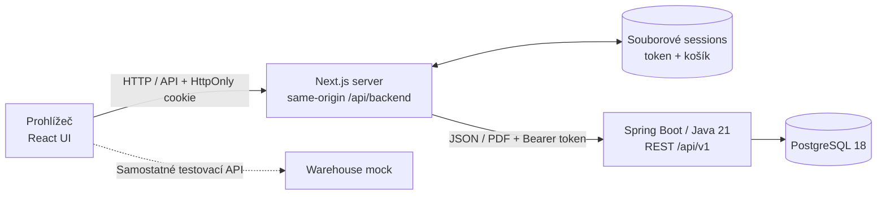
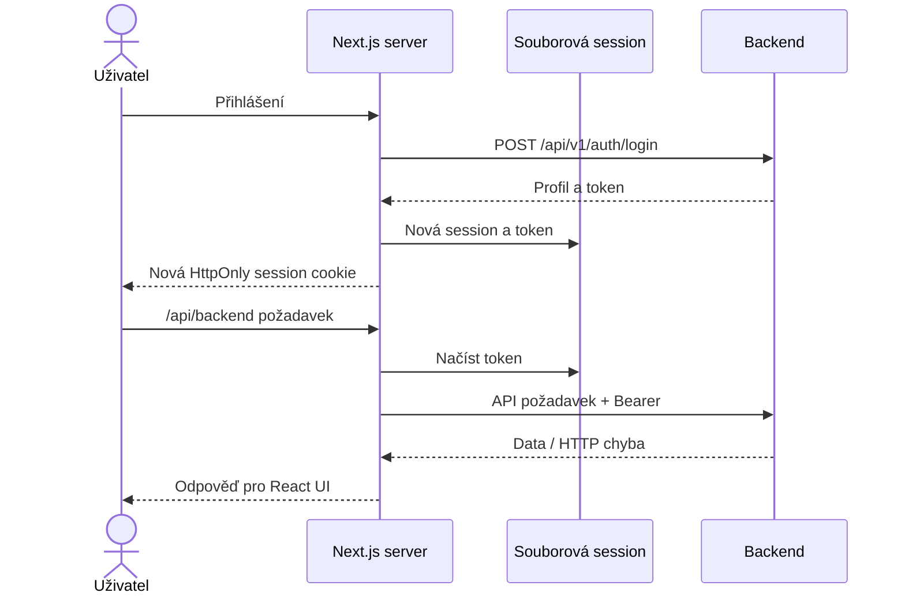

# ERP — úplná architektura a provoz první Next.js varianty

Podklady: [frontend](./erp-base-nextjs),
[Compose](./docker-compose-NEXTJS.yml),
[README frontendu](./erp-base-nextjs/README.md).
Tato varianta používá Next.js 16.4.0, React 19.3.0 a TypeScript.
Verze jsou specifické pro tento frontend, nikoli pro celý repozitář.

## 1. Architektura



React komponenty volají same-origin frontend API; server přeposílá
požadavky na backend. PHP ani JSP nejsou za běhu potřeba.
Backend token, guest cart a session data jsou serverové. Browser dostává
neprůhledný session identifikátor, nikoli backend token.

## 2. Workflow



Login rotuje session ID. Expirace je 30 minut neaktivity nebo osm hodin
celkem. `COOKIE_SECURE=true` používejte při HTTPS, ne pro obyčejný lokální HTTP.
Souborový store není distribuovaný a automatické škálování frontendu
neřeší. Pro doménové operace, sklad, checkout a promo viz
[společná workflow backendu](./ARCHITECTURE-FULL-JSP.md).

## 3. Instalace a lokální běh

Instalujte Git a [Node.js 22+](https://nodejs.org/en/download) s npm.
Pro lokální backend potřebujete Java 21, Maven a databázi podle
[lokálního setupu](./ARCHITECTURE-FULL-JSP.md).

Z kořene repozitáře:

```bash
cd erp-base-nextjs
cp .env.example .env.local
npm ci
npm run dev
```

`.env.local` kopírujte jen poprvé. Lokálně použijte
`BACKEND_URL=http://localhost:8080`, `SESSION_DIR=./var/sessions`,
`COOKIE_SECURE=false`. Otevřete `http://localhost:3000`.
Build a produkční lokální server:

```bash
npm run build
npm start
```

Kontroly:

```bash
npm run typecheck
npm test
```

## 4. Docker Compose

Nainstalujte [Docker Engine/Desktop a Compose v2](https://docs.docker.com/).
Build v Dockeru nepotřebuje hostitelský Node/JDK.

```bash
docker network inspect projects-network >/dev/null 2>&1 || docker network create projects-network
docker compose -f docker-compose-NEXTJS.yml up --build -d
docker compose -f docker-compose-NEXTJS.yml ps
docker compose -f docker-compose-NEXTJS.yml logs --tail=100 frontend backend
curl -fsS http://localhost:3000/login >/dev/null
curl -fsS http://localhost:8080/api/v1/settings/public
```

Frontend je na 3000, backend na 8080, PostgreSQL na host portu 5434
a mock na 8091. Uvnitř sítě je backend `http://backend:8080`.
Frontend má volume `erp-nextjs-sessions` na `/app/var/sessions`;
databáze má `erp-postgres-data`.
Session volume přetrvá výměnu kontejneru, ale není sdílený
distribuovaný session systém. Session ostatních variant nejsou zaměnitelné.

```bash
docker compose -f docker-compose-NEXTJS.yml down
```

Nepoužívejte `-v`, pokud chcete zachovat databázi a sessions.
Ostatní varianty nejprve zastavte: jejich host porty kolidují.

## 5. Kubernetes / Minikube

**Pro tuto variantu není připravený Kubernetes manifest.**
Po sjednocení DB portů popsaném v
[Kubernetes návodu](./ARCHITECTURE-FULL-JSP.md) lze adaptovat JSP manifest
do samostatného `kubernetes-NEXTJS.yml`:

- Namespace všech objektů: `erp-nextjs`.
- Frontend image: `erp-base-nextjs:nextjs-local`, policy `Never`.
- Frontend port a Service: 3000; pojmenovaný port `http` použijte také v probes.
- Odstraňte JSP frontend init kontejner `wait-for-backend`.
- Zachovejte interní `BACKEND_URL`; přidejte `SESSION_DIR=/app/var/sessions`
  a `COOKIE_SECURE=false` pro lokální HTTP.
- Přidejte frontendový PVC s `ReadWriteOnce` a mountem `/app/var/sessions`.
- Zachovejte jednu repliku a `Recreate`, dokud není distribuovaný session store.

Backend, PostgreSQL a mock převezměte jako společné komponenty.
Kopírování manifestu není přenos dat: nový namespace má vlastní DB PVC a Secret.
Po přípravě manifestu:

```bash
minikube start --driver=docker
minikube addons enable storage-provisioner
minikube addons enable default-storageclass
docker build -t erp-base-nextjs:nextjs-local ./erp-base-nextjs
docker build -t erp-backend:jsp-local ./erp-backend
docker build -t erp-remote-warehouse:jsp-local ./erp-remote-warehouse
minikube image load erp-base-nextjs:nextjs-local erp-backend:jsp-local erp-remote-warehouse:jsp-local
```

Vytvořte namespace `erp-nextjs` a DB Secret analogicky k
[JSP nasazení](./ARCHITECTURE-FULL-JSP.md), potom:

```bash
minikube kubectl -- apply --dry-run=client --validate=strict -f kubernetes-NEXTJS.yml
minikube kubectl -- apply -f kubernetes-NEXTJS.yml
minikube kubectl -- -n erp-nextjs rollout status deployment/frontend --timeout=300s
minikube kubectl -- -n erp-nextjs port-forward service/frontend 3000:3000
```

Příkazy předpokládají vytvoření adaptovaného manifestu; tento dokument
ho nedodává. Před HTTP ověřením zkontrolujte backend, PostgreSQL a oba PVC.
Pro rollback potřebujete předchozí neměnný image tag; `rollout undo` nevrací
databázové migrace. Produkční provoz vyžaduje TLS, zálohy, secrets a session
řešení pro případné více replik.
