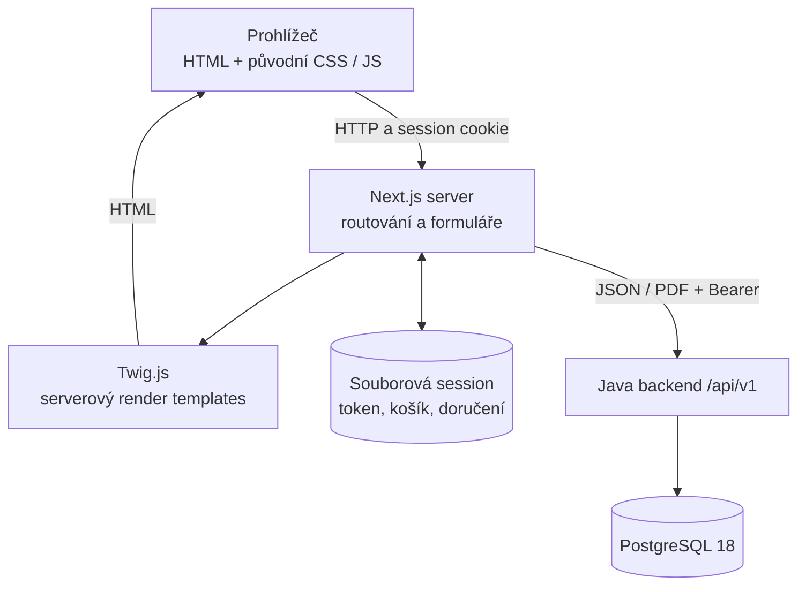
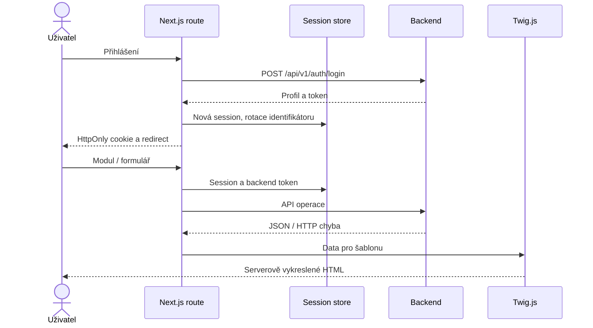

# ERP — úplná architektura a provoz Next.js / Twig.js

Podklady: [frontend](./erp-base-nextjs2),
[Compose](./docker-compose-NEXTJS2.yml),
[README frontendu](./erp-base-nextjs2/README.md).
Stack: Next.js 16.3.8, React 19.2.8, TypeScript, Twig.js 3.0.0, Node.js 22.
Tato varianta zachovává původní PHP vzhled a DOM, ale PHP nepotřebuje.

## 1. Architektura



Stránky nejsou komponentový React přepis: Twig.js renderuje HTML na serveru,
React je součástí Next.js runtime. Prohlížeč používá zachované imperativní
skripty a CSS. PHP server, PHP session ani JSP runtime nejsou potřeba.

## 2. Zásadní workflow



Session má 30minutový idle a osmihodinový absolutní limit. Token, košík
a doručení jsou serverové; cookie je neprůhledný identifikátor.
Session této varianty není PHP session.
Workflow skladu, objednávek, faktur a promo jsou backendová a jsou popsána
ve [společném dokumentu](./ARCHITECTURE-FULL-JSP.md). Frontendový vzhled
nemění pravidla backendu ani demonstrační charakter platby kartou.

## 3. Instalace a lokální běh

Instalujte Git, [Node.js 22+](https://nodejs.org/en/download) a npm.
Java backend a databázi spusťte podle
[lokálního setupu](./ARCHITECTURE-FULL-JSP.md).

```bash
cd erp-base-nextjs2
cp .env.example .env.local
npm ci
npm run dev
```

Příkazy začínají v kořeni repozitáře; `.env.local` nevytvářejte kopírováním
znovu, pokud již obsahuje vlastní nastavení. Použijte
`BACKEND_URL=http://localhost:8080`, `SESSION_DIR=./var/sessions`,
`COOKIE_SECURE=false`. Web: `http://localhost:3000`.

```bash
npm run typecheck
npm run build
npm test
npm start
```

`npm start` je produkční lokální server po buildu; nepouštějte jej současně
s dev serverem na stejném portu. Integrační frontendové testy spouštějí
vlastní backend mock podle test runneru.

## 4. Docker Compose

Instalace: [Docker Engine/Desktop s Compose v2](https://docs.docker.com/).
Node a Maven pro kontejnery zajišťují Docker build stages.

```bash
docker network inspect projects-network >/dev/null 2>&1 || docker network create projects-network
docker compose -f docker-compose-NEXTJS2.yml up --build -d
docker compose -f docker-compose-NEXTJS2.yml ps
docker compose -f docker-compose-NEXTJS2.yml logs --tail=100 frontend backend
curl -fsS http://localhost:3000/login >/dev/null
curl -fsS http://localhost:8080/api/v1/settings/public
```

Porty: frontend 3000, backend 8080, PostgreSQL host 5434 / kontejner 5432,
mock 8091. Frontend používá `http://backend:8080`; image obsahuje i `templates`.
Volume `erp-nextjs2-sessions` je připojen na `/app/var/sessions`;
databázový volume má klíč `erp-postgres-data`.
Pro HTTPS nastavte `COOKIE_SECURE=true`.

```bash
docker compose -f docker-compose-NEXTJS2.yml down
```

`down` bez `-v` zachová pojmenované volumes. Varianty se na výchozích
host portech nesmí překrývat. Souborový session store není automaticky
bezpečný distribuovaný store pro více frontendových replik.

## 5. Kubernetes / Minikube

**Repozitář obsahuje pouze JSP Kubernetes manifest, nikoli Twig.js variantu.**
Pro vlastní `kubernetes-NEXTJS2.yml` převezměte společný backend, PostgreSQL
a mock z [JSP manifestu](./kubernetes-JSP.yml). Nejdřív opravte nesoulad
DB portů podle [JSP Kubernetes návodu](./ARCHITECTURE-FULL-JSP.md).

Změny adaptace:

| Nastavení | Next.js2 |
| --- | --- |
| Namespace všech objektů | `erp-nextjs2` |
| Frontend image | `erp-base-nextjs2:nextjs2-local`, policy `Never` |
| Frontend port a Service | 3000, pojmenovaný `http` |
| Frontend env | Interní `BACKEND_URL`, `SESSION_DIR=/app/var/sessions`, lokálně `COOKIE_SECURE=false` |
| Frontend storage | Vlastní PVC `ReadWriteOnce`, mount `/app/var/sessions` |
| Frontend init | Odstranit JSP `wait-for-backend` |
| Frontend strategie | Jedna replika, `Recreate` |

Po přípravě samostatného manifestu:

```bash
minikube start --driver=docker
minikube addons enable storage-provisioner
minikube addons enable default-storageclass
docker build -t erp-base-nextjs2:nextjs2-local ./erp-base-nextjs2
docker build -t erp-backend:jsp-local ./erp-backend
docker build -t erp-remote-warehouse:jsp-local ./erp-remote-warehouse
minikube image load erp-base-nextjs2:nextjs2-local erp-backend:jsp-local erp-remote-warehouse:jsp-local
```

Namespace `erp-nextjs2` a DB Secret vytvořte podle
[JSP postupu](./ARCHITECTURE-FULL-JSP.md), s nahrazením namespace:

```bash
minikube kubectl -- apply --dry-run=client --validate=strict -f kubernetes-NEXTJS2.yml
minikube kubectl -- apply -f kubernetes-NEXTJS2.yml
minikube kubectl -- -n erp-nextjs2 rollout status deployment/frontend --timeout=300s
minikube kubectl -- -n erp-nextjs2 port-forward service/frontend 3000:3000
```

Tyto příkazy vyžadují vytvoření variantního manifestu; nevztahují se
k existujícímu JSP souboru. Ověřte také backend a DB/session PVC.
PVC nepřevezme Compose data automaticky.
Rollout/rollback potřebuje neměnné image tagy a kompatibilní migrace;
návrat Deploymentu nevrací schéma. Před více replikami vyřešte sdílené
sessions a před produkcí TLS, secrets a zálohy.
