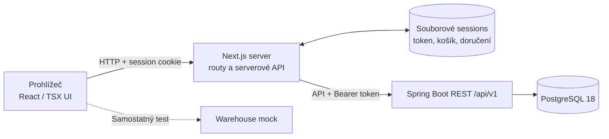
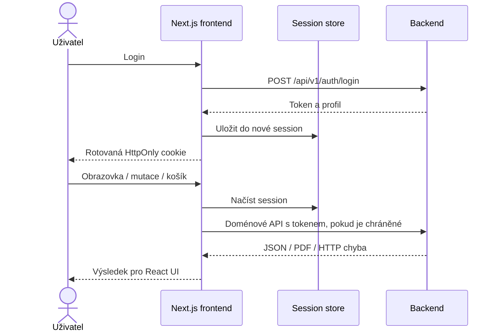

# ERP — úplná architektura a provoz Next.js / React TSX

Podklady: [frontend](./erp-base-nextjs3),
[Compose](./docker-compose-NEXTJS3.yml),
[README frontendu](./erp-base-nextjs3/README.md).
Stack: Next.js 16.3.8, React 19.2.8, TypeScript, Node.js 22.
Jde o komponentovou alternativu k Twig.js variantě, nikoli její runtime.

## 1. Architektura



Obrazovky jsou React/TSX komponenty; nevyžadují Twig, PHP ani JSP.
Serverová session uchovává backend token i guest cart/delivery data.
Backend zůstává společným zdrojem pravidel a PostgreSQL zdrojem obchodních dat.

## 2. Workflow



Browser nemá backend token. Session má omezenou životnost, ID se při loginu
rotuje a její souborový store je určen pro jednu frontendovou repliku.
Společné workflow skladu, checkoutu, faktur a kampaní je v
[backendovém popisu](./ARCHITECTURE-FULL-JSP.md).
CARD checkout je demonstrace; neprovádí reálnou platbu ani vyskladnění.

## 3. Instalace a lokální běh

Instalujte Git, [Node.js 22+](https://nodejs.org/en/download) a npm.
Pro backend/database použijte
[Java a PostgreSQL setup](./ARCHITECTURE-FULL-JSP.md).
Z kořene repozitáře:

```bash
cd erp-base-nextjs3
cp .env.example .env.local
npm ci
npm run dev
```

`.env.local` kopírujte pouze poprvé. Nastavte
`BACKEND_URL=http://localhost:8080`, `SESSION_DIR=var/sessions`
a `COOKIE_SECURE=false` pro lokální HTTP. Web je na `http://localhost:3000`.

```bash
npm run typecheck
npm run build
npm test
npm start
```

`npm start` spouští produkční lokální server z dokončeného buildu;
dev server musí být na stejném portu zastavený.

## 4. Docker Compose

Předpoklad: [Docker Engine/Desktop a Compose v2](https://docs.docker.com/).
Hostitelský Node ani JDK není pro kontejnerový build potřeba.

```bash
docker network inspect projects-network >/dev/null 2>&1 || docker network create projects-network
docker compose -f docker-compose-NEXTJS3.yml up --build -d
docker compose -f docker-compose-NEXTJS3.yml ps
docker compose -f docker-compose-NEXTJS3.yml logs --tail=100 frontend backend
curl -fsS http://localhost:3000/login >/dev/null
curl -fsS http://localhost:8080/api/v1/settings/public
```

Porty: frontend 3000, backend 8080, DB 5434 na hostiteli / 5432 uvnitř,
warehouse mock 8091. Interní backend URL je `http://backend:8080`.
`erp-nextjs3-sessions` ukládá session soubory do `/app/var/sessions`;
`erp-postgres-data` ukládá databázi.
Pro HTTPS změňte `COOKIE_SECURE=true`.

```bash
docker compose -f docker-compose-NEXTJS3.yml down
```

Nepřidávejte `-v`, pokud chcete zachovat databázi a sessions. Při přepínání
variant zastavte předchozí Compose souborem; výchozí host porty kolidují.
Session data nejsou automaticky kompatibilní mezi frontendovými variantami.

## 5. Kubernetes / Minikube

**Hotový Kubernetes manifest pro Next.js3 v repozitáři není.**
Samostatný `kubernetes-NEXTJS3.yml` lze připravit adaptací
[JSP manifestu](./kubernetes-JSP.yml), ale nejprve sjednoťte DB porty podle
[Kubernetes upozornění](./ARCHITECTURE-FULL-JSP.md).

Požadované rozdíly:

- Namespace všech objektů `erp-nextjs3`.
- Frontend image `erp-base-nextjs3:nextjs3-local`, policy `Never`.
- Frontend containerPort, Service a probes na pojmenovaném portu `http`: 3000.
- Odstranit JSP init kontejner `wait-for-backend`.
- Nastavit `BACKEND_URL=http://backend:8080`,
  `SESSION_DIR=/app/var/sessions`, `COOKIE_SECURE=false` pro lokální HTTP.
- Přidat vlastní frontendový PVC `ReadWriteOnce` a mount `/app/var/sessions`.
- Ponechat jednu repliku a `Recreate`; více replik potřebuje jiný session model.

Backend, PostgreSQL a mock použijte jako stejné společné komponenty.
Nový namespace/PVC znamená samostatná data, nikoli automatický import.
Po vytvoření adaptovaného manifestu:

```bash
minikube start --driver=docker
minikube addons enable storage-provisioner
minikube addons enable default-storageclass
docker build -t erp-base-nextjs3:nextjs3-local ./erp-base-nextjs3
docker build -t erp-backend:jsp-local ./erp-backend
docker build -t erp-remote-warehouse:jsp-local ./erp-remote-warehouse
minikube image load erp-base-nextjs3:nextjs3-local erp-backend:jsp-local erp-remote-warehouse:jsp-local
```

Vytvořte namespace `erp-nextjs3` a DB Secret podle
[JSP návodu](./ARCHITECTURE-FULL-JSP.md), poté:

```bash
minikube kubectl -- apply --dry-run=client --validate=strict -f kubernetes-NEXTJS3.yml
minikube kubectl -- apply -f kubernetes-NEXTJS3.yml
minikube kubectl -- -n erp-nextjs3 rollout status deployment/frontend --timeout=300s
minikube kubectl -- -n erp-nextjs3 port-forward service/frontend 3000:3000
```

Příkazy předpokládají nový variantní manifest, který tento dokument nevytváří.
Zkontrolujte připravenost backendu/databáze a oba PVC.
Rollback s neměnnými image tagy vrací pouze Deployment, nikoli migrace
a data. Produkční deployment potřebuje TLS, secrets, zálohy a vhodný
session store; existující lokální manifest není produkční referenční řešení.
