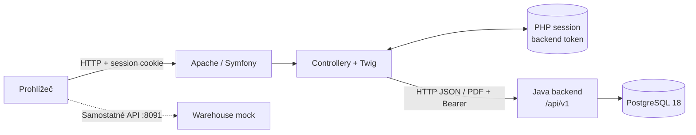
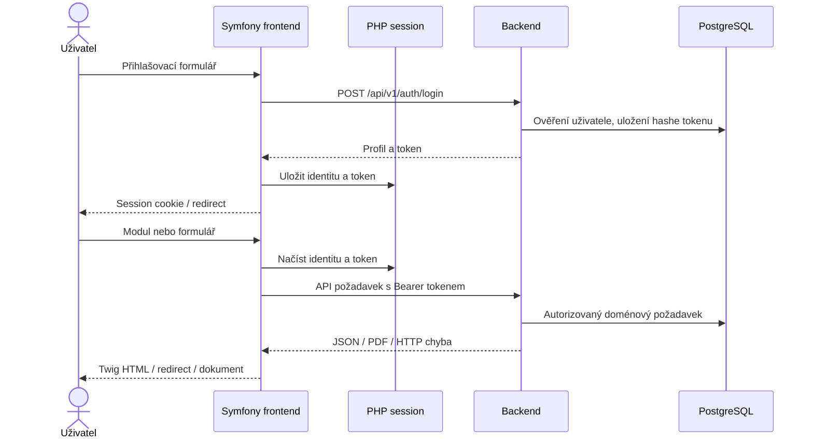

# ERP — úplná architektura a provoz PHP varianty

PHP varianta používá stejný Java backend a PostgreSQL jako JSP, ale webové
rozhraní vykresluje Symfony. Zdrojové soubory:
[frontend](./erp-base-php), [Compose](./docker-compose-PHP.yml),
[komponentní popis](./docs/architecture/erp-base-php.md).
Společné doménové workflow a instalace backendu jsou v
[JSP dokumentu, sekce 3–5](./ARCHITECTURE-FULL-JSP.md).

## 1. Architektura

| Vrstva | Technologie | Odpovědnost |
| --- | --- | --- |
| Frontend | Symfony 7.4, Twig, PHP | HTML, formuláře, session, API klient |
| Docker runtime | PHP 8.4 / Apache | Document root `public`, mod_rewrite |
| Backend | Spring Boot 4.1.1 / Java 21 | Autoritativní ERP API |
| Databáze | PostgreSQL 18 | Obchodní data a API sessions |
| Mock | Java HTTP API | Samostatný testovací katalog |

Composer požaduje PHP alespoň 8.2 a `ext-json`; při lokální instalaci
respektujte také požadavky lockfile. Docker používá PHP 8.4.



Backend token se neposílá do browserového úložiště: Symfony jej drží
v serverové PHP session. Cookies používají HttpOnly, SameSite=Lax a
Secure podle prostředí. Compose neobsahuje samostatný PHP session volume;
výměna kontejneru může zrušit přihlášení.

## 2. Zásadní frontendové workflow



Symfony request subscriber kontroluje přístup a expiraci session.
Backend má poslední slovo o oprávněních. Skladové pohyby, objednávky,
faktury a promo kampaně mají stejné backendové chování popsané ve
[společných workflow](./ARCHITECTURE-FULL-JSP.md).
Platba kartou je demonstrace; checkout neodečítá zásoby.

## 3. Instalace a lokální vývoj

Instalujte Git, PHP a Composer podle
[PHP](https://www.php.net/manual/en/install.php) a
[Composer](https://getcomposer.org/download/).
Pro lokální server lze použít
[Symfony CLI](https://symfony.com/download); jde o dodatečný nástroj,
nikoli závislost dodanou repozitářem.
Databázi a Java backend spusťte podle
[lokálního setupu](./ARCHITECTURE-FULL-JSP.md).

Z kořene repozitáře:

```bash
cd erp-base-php
cp .env.dist .env
composer install
composer check-platform-reqs
```

Kopírování `.env` proveďte pouze při prvním setupu, abyste nepřepsali vlastní
konfiguraci. Pro lokální prostředí nastavte `BACKEND_URL=http://localhost:8080`,
`APP_ENV=dev`, `APP_DEBUG=1` a vlastní `APP_SECRET`; tajemství necommitujte.
Composer post-install skripty připravují cache a assets.
Pokud máte Symfony CLI:

```bash
symfony server:start --port=4201 --no-tls
```

Otevřete `http://localhost:4201`. Tento lokální server je vývojový;
produkční běh používá Apache podle Dockerfile. Pokud nechcete instalovat
PHP server a CLI, použijte ověřenou Compose cestu níže.

## 4. Docker Compose

Nainstalujte a spusťte Docker Engine/Desktop s Compose v2 podle
[Docker dokumentace](https://docs.docker.com/).
Hostitelský PHP ani JDK není pro build kontejnerů potřeba.

```bash
docker network inspect projects-network >/dev/null 2>&1 || docker network create projects-network
docker compose -f docker-compose-PHP.yml up --build -d
docker compose -f docker-compose-PHP.yml ps
docker compose -f docker-compose-PHP.yml logs --tail=100 frontend backend
curl -fsS http://localhost:4201/login >/dev/null
curl -fsS http://localhost:8080/api/v1/settings/public
```

| Host port | Cíl |
| --- | --- |
| 4201 | Apache frontend:80 |
| 8080 | backend:8080 |
| 5434 | postgres:5432 |
| 8091 | remote-warehouse-mock:8080 |

Služby používají `projects-network`; backend frontend volá jako
`http://backend:8080`. Database volume je `erp-postgres-data`.
Přepnutí varianty začněte zastavením té původní jejím Compose souborem.

```bash
docker compose -f docker-compose-PHP.yml down
```

Nepoužívejte `down -v`, chcete-li zachovat databázi.
Vývojové DB údaje v Compose a `.env.dist` nejsou produkční secrets.

## 5. Cesta do Kubernetes

**Repozitář nemá připravený PHP Kubernetes manifest.** Existující
[JSP manifest](./kubernetes-JSP.yml) nenasazuje Symfony.
Nejprve sjednoťte jeho DB porty podle upozornění v
[Kubernetes návodu](./ARCHITECTURE-FULL-JSP.md), pak připravte samostatnou
PHP kopii například `kubernetes-PHP.yml`:

| Položka | Změna pro PHP |
| --- | --- |
| Namespace všech objektů | `erp-php` |
| Frontend image | `erp-base-php:php-local`, `imagePullPolicy: Never` |
| Frontend containerPort | 80, pojmenovaný `http` |
| Frontend Service | `port: 80`, `targetPort: http` |
| Frontend probes | TCP `http` na portu 80 |
| Frontend init | Odstranit JSP init `wait-for-backend`; aplikace musí zvládat nedostupnost API |
| Frontend env | Zachovat `BACKEND_URL=http://backend:8080`; dodat vlastní `APP_SECRET` přes Secret |
| Frontend strategie | Jedna replika, `Recreate`, dokud nejsou sdílené sessions |

Backend, databázový StatefulSet, PVC a mock zůstávají stejnými komponentami.
Použijte izolovaný namespace a vlastní DB Secret; databáze se tím automaticky
nepřenese z Compose ani z JSP namespace.
Po vytvoření a kontrole PHP manifestu:

```bash
minikube start --driver=docker
minikube addons enable storage-provisioner
minikube addons enable default-storageclass
docker build -t erp-base-php:php-local ./erp-base-php
docker build -t erp-backend:jsp-local ./erp-backend
docker build -t erp-remote-warehouse:jsp-local ./erp-remote-warehouse
minikube image load erp-base-php:php-local erp-backend:jsp-local erp-remote-warehouse:jsp-local
```

Vytvořte namespace `erp-php` a potřebné Secrets analogicky k
[JSP nasazení](./ARCHITECTURE-FULL-JSP.md), poté:

```bash
minikube kubectl -- apply --dry-run=client --validate=strict -f kubernetes-PHP.yml
minikube kubectl -- apply -f kubernetes-PHP.yml
minikube kubectl -- -n erp-php rollout status deployment/frontend --timeout=300s
minikube kubectl -- -n erp-php port-forward service/frontend 4201:80
```

Příkazy s PHP manifestem jsou postup adaptace, nikoli příkazy pro již
existující soubor. Ověřte také připravenost backendu a databáze.
Pro rollout/rollback používejte neměnné image tagy; rollback nevrací migrace.
Produkční nasazení potřebuje HTTPS, bezpečné secrets, zálohy a vyřešené
session úložiště. Pouhé zvýšení replik bez sessions není bezvýpadkový rollout.
